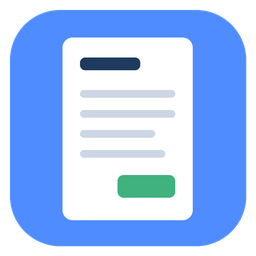

<p align="center">
  
</p>

<h1 align="center">QuickInvoice</h1>

<p align="center">A dead-simple invoice maker for Windows — your logo, the customer, the work, a total, and a clean PDF.</p>

<p align="center">
  <a href="LICENSE"></a>
  
  
</p>

---

## Why

Most invoicing software is built for accountants: accounts, subscriptions, tax tables, dashboards. Plenty of tradespeople and small one-person businesses just need to hand a customer a tidy, professional invoice. QuickInvoice is built for someone who isn't comfortable with computers — one window, plain labels, big buttons, and a PDF at the end.

## Features

- **Your logo at the top** — pick any picture (PNG, JPG, GIF, BMP, WebP…); it's resized and remembered.
- **Business info saved once** — your name, address, phone and email fill in automatically on every invoice.
- **Bill To header** — customer name, address, email and phone above the work.
- **Line-by-line work** — add as many lines as you need; press Enter to jump to the next line.
- **Prices are optional**
  - Put a price on each line and the total adds itself up, or
  - leave the prices blank and type one flat total for the whole job.
  - Prices-free invoices drop the amount column entirely so the PDF looks intentional.
  - "Let me type the total myself" overrides the automatic sum (discounts, rounding).
- **Forgiving price entry** — `150`, `$150`, `1,250.50` and `-25` (discounts) all work; anything else is highlighted red.
- **Automatic invoice numbers** — 0001, 0002, … (editable).
- **Clean, printable PDF** — saved to `Documents\Invoices` and opened as soon as it's made. Multi-page invoices repeat the column header and number their pages.
- **Optional notes** — payment terms, a thank-you, etc. (a default is saved for you).

## Requirements

- Windows 10 or 11
- To run from source: Python 3.13 with `reportlab` and `Pillow`

## Installation

### Installer (recommended)

1. Download `QuickInvoice-Setup-x.x.x.exe` from the [Releases](https://github.com/nullifiedharp/QuickInvoice/releases) page.
2. Run it. It installs for the current user only — no administrator password needed — and puts a shortcut on the Desktop.

### Run from source

```bat
git clone https://github.com/nullifiedharp/QuickInvoice.git
cd QuickInvoice
pip install -r requirements.txt
python quickinvoice.py
```

### Build it yourself

Double-click `build.bat`. It installs the requirements and PyInstaller, builds `dist\QuickInvoice.exe`, installs Inno Setup through `winget` if it isn't already present, and produces the installer in the `installer` folder.

## Usage

1. **First launch:** fill in *My Business Info* (you only do this once) and click **Choose Logo…** if you have one.
2. **Bill To:** type the customer's name, and whatever of address, email and phone you want on the invoice.
3. **Work Done:** one line per job. Add a price to each line, or leave them blank.
4. **Total:** fills itself in when lines have prices; otherwise type the flat amount.
5. Click **Create Invoice PDF**. The PDF opens so you can print or email it.
6. Click **Start New Invoice** for the next customer — the number moves up by one.

**Open Invoices Folder** takes you to every invoice you've made.

## How it works

- The window is plain Python `tkinter`; the PDF is laid out with `reportlab` (US Letter, Helvetica, so nothing depends on fonts installed on the PC).
- Your chosen logo is converted to a trimmed PNG and stored with the settings, so moving or deleting the original picture doesn't break anything.
- Settings (business info, logo, currency symbol, next invoice number, save folder) live in `%APPDATA%\QuickInvoice\settings.json`.
- Invoices are saved as `Invoice 0001 - Customer Name.pdf` in the folder set in *My Business Info* (default `Documents\Invoices`).

## Notes and limitations

- No tax/VAT lines yet — include tax as its own line if you need it.
- Invoices aren't stored as editable records; the PDF is the record. To fix one, make it again with the same number and replace it.
- Page size is US Letter.
- The currency symbol is changeable in *My Business Info*; amounts are always shown with two decimals.

## License

QuickInvoice is free software released under the [GNU General Public License v3.0](LICENSE).

Copyright © 2026 NullHarp
